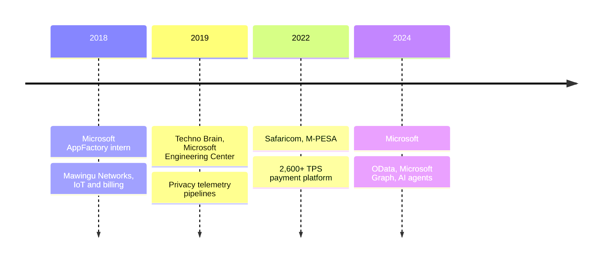

  
  
  
  

### I work on the open-source .NET libraries that power OData APIs, including Microsoft Graph, and I build AI agents that make engineers faster.

Most of my day job is making APIs **faster, safer and easier to ship**: profiling hot paths in a JSON reader, closing resource-exhaustion holes before attackers find them, and running releases for packages used across the .NET ecosystem. The rest is building **documentation-grounded AI agents** that turn incidents, docs and tribal knowledge into answers and pull requests.

Before Microsoft, I helped scale **M-PESA**, one of the world's largest mobile-money platforms, to **2,600+ transactions per second**.

---

## 🧭 By the numbers

<table>
  <tr>
    <td align="center" width="25%"><h2>340+</h2>commits to <a href="https://github.com/OData/odata.net">odata.net</a> &amp; <a href="https://github.com/OData/AspNetCoreOData">AspNetCoreOData</a> since 2024</td>
    <td align="center" width="25%"><h2>100+</h2>pull requests merged across the OData .NET stack</td>
    <td align="center" width="25%"><h2>8 h → 9 min</h2>M-PESA upgrade downtime, cut on platforms built for 99.99% availability</td>
    <td align="center" width="25%"><h2>60%</h2>less manual processing from privacy-telemetry ETL pipelines</td>
  </tr>
</table>

  
  

Live download counts of packages I help build and release.

## 🔬 Open-source work I'm proud of

<b>🛡️ Security hardening</b>: closing denial-of-service and data-exposure paths in ASP.NET Core OData

- [Bounded `MaxReceivedMessageSize` default](https://github.com/OData/AspNetCoreOData/pull/1574) to stop unbounded allocation (CWE-770)
- [Property restrictions and query limits for `$apply` / `$compute`](https://github.com/OData/AspNetCoreOData/pull/1594)
- [Configurable timeout for `matchesPattern`](https://github.com/OData/AspNetCoreOData/pull/1593) to defuse regex-based slowdowns
- [Opt-in diagnostic logging for query-validation failures](https://github.com/OData/AspNetCoreOData/pull/1592)
- Fixes for paging bypass via `Prefer: maxpagesize=0` (CWE-1284), nested `Delta<T>` allow-lists, and EDM-boundary checks for open types

<b>⚡ Performance</b>: fewer allocations on the hottest paths

- [Vectorized whitespace skipping in the JSON reader](https://github.com/OData/odata.net/pull/3381)
- [Avoid double string allocation in `JsonReader`](https://github.com/OData/odata.net/pull/3416) and `ReadOnlySpan`/`ReadOnlyMemory` refactors
- [`ODataNullValue` singleton](https://github.com/OData/odata.net/pull/3284) to remove repeated allocations
- [Built-in `Encoding.CreateTranscodingStream`](https://github.com/OData/odata.net/pull/3403) replacing a custom stream

<b>🧱 Modernizing the API surface</b>: moving OData onto modern .NET

- Replace `Edm.Date` / `Edm.TimeOfDay` with `System.DateOnly` / `System.TimeOnly` in [ODL](https://github.com/OData/odata.net/pull/3408) and [ASP.NET Core OData](https://github.com/OData/AspNetCoreOData/pull/1541) for the 10.x line
- [Async APIs for `CsdlWriter` and `SchemaWriter`](https://github.com/OData/odata.net/pull/3006)
- [`ShouldReadPropertyAsStream` API](https://github.com/OData/odata.net/pull/3477) for streaming with property annotations
- [Enums as keys in the OData client](https://github.com/OData/odata.net/pull/3013), plus `IAsyncEnumerable` support and `TryValidate` for query options

<b>🚀 Release engineering</b>: shipping 7.x, 8.x, 9.x and the 10.0 previews

- Drove version releases across four supported major lines
- Built nightly vs. release publishing modes, internal feed publishing and symbol pushing
- Automated stable OData dependency updates and package-version validation in CI
- Adopted NuGet Central Package Management; ported large legacy test suites to modern E2E tests

## 🤖 What else I build

| | |
|---|---|
| **AI agents & RAG** | Documentation-grounded agents and reusable skills that answer engineering questions, turn incidents into work items, plan implementations and check PRs, with human review gates for security and breaking changes. |
| **Platform self-service** | Azure DevOps automation for pipeline permissions and repo migration using workload identity federation, ownership checks, dry-run mode and full audit trails. |
| **API reliability** | Schema-contract and workload compatibility validation for Microsoft Graph onboarding, backed by telemetry, monitors and alerts. |
| **Payments at scale** | M-PESA Payment Gateway and API upgrades connecting banks, SACCOs, fintechs and merchants. |

## 🛠️ Toolbox

  

## 🗺️ The journey

🎓 **BSc Microprocessor Technology & Instrumentation**, University of Nairobi

## 💬 Let's talk about

C# performance · API design · OData · security hardening · building AI agents that people actually use · or the best cycling routes around Nairobi 🚴

<a href="./CV.md"><b>📄 Read the full CV →</b></a>

